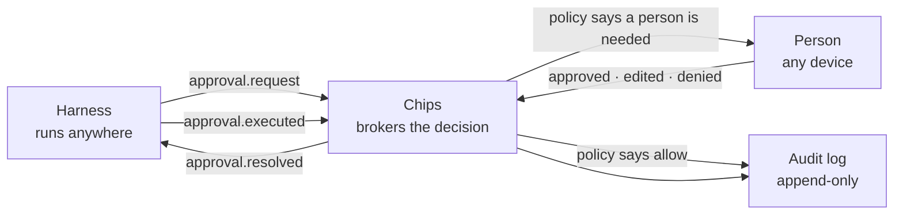

An approval is the thing a group chat cannot do: an action, a preview or diff, a risk class, an
expiry, and a list of who may answer — resolved as approved, edited or denied, by whom, when.

## The loop

Chips holds the decision, never the credentials. It decides nothing and executes nothing: the
[policy engine](/concepts/policy/) says whether a person is needed, the person answers from
wherever they are, and the answer goes back to the harness.

## Ask the question on the card

A person answers a question, so send one. The card leads with it, and a notification says it:

| Field | What it holds |
| --- | --- |
| `question` | The question the person answers yes or no, as one sentence in plain words: `Turn off the Robinhood connector?` |
| `effect` | What a yes does, in a sentence or two: `Its 73 tools disappear from every Space.` |
| `lasts` | `once` for this action alone, or `standing` for a grant that holds until it is taken back, such as a folder an agent may keep working in. |

Write them where your harness knows what the action does, and in the person's words, not the
tool's. Leave the details to the preview: the command, the diff, the email itself.

All three are optional. Without a question the card is headed by the preview's `title`, and
without that by the action's kind, `shell.exec`, which is the policy engine's word and reads like
it. A label is not a question: `Kit edit: connectors/robinhood.yaml` is what changed, and the
person needs to know that it turns the connector off.

An ask whose input has a `command` is drawn one part to a line, the way Chips reads it, with the
words a standing yes would keep in bold, thrown-away output struck through, and a write into a file
in red. So a question needn't quote the command: one it quotes at its end is dropped from the
headline, and a preview that is the input as JSON, or says the command again, gives way to the
command's own lines. A preview that says something else still shows.

## A decision is more than yes or no

| Part | What it means |
| --- | --- |
| `decision` | `approved`, `edited`, `denied`, or `expired`. |
| `scope` | `once`, `session`, or `always`. `always` becomes a policy rule. |
| `for_minutes` | With `once` and a yes: everything the asking agent asks in that space goes ahead for this long. See [A yes that holds on](#a-yes-that-holds-on). |
| `until_stopped` | With `once` and a yes, instead of `for_minutes`: the same, until a person stops it. |
| `everywhere` | With `always`: the rule holds in every space, not only this one. An owner's or an admin's to give. |
| `updated_input` | The edited action, when the approver changed it before allowing. |
| `reason` | Why. The harness gets to read this. |
| `resolved_by` | Who answered, or `system` on an expiry. |
| `resolved_elsewhere` | Sent to the surfaces that did not answer first. |

## This session and Always are kept by Chips

A harness keeps what it can of a scope, and many keep only one answer at a time: OpenClaw's own
commands take allow-once and nothing longer. So Chips keeps the rest itself, whatever the harness
can. *Always* is a rule in that harness's
[policy](/concepts/policy/#what-a-decision-leaves-behind) for the space it was said in, or for every
space when an owner or an admin says so. `scope: "session"` is a rule for the rest of the run: the
apps no longer offer it, since *For an hour* took its place, and it stays for harnesses and older
apps. The harness still hears the scope in `approval.resolved`, and may keep it too.

On a command, either rule remembers how each part of the command starts, and not the rest of it:
the program and the word that picks what it does where it has one (`git log`, `pnpm test`,
`node game.js`, `ls -la`), otherwise the program alone (`cat`, `cd`). Always on `git log --oneline`
covers a later `git log -5` and not `git status`. A later command goes ahead only when every part of
it is covered, and one part nothing covers brings the whole command to a person. A command Chips
can't read part by part, or one that uses `rm`, `sudo`, `git push` and the like, is offered no
Always. An ask that isn't a command, `file.edit` for one, is matched by its kind and its flags, so
Always there is meant for a kind of action.

A later ask the rule covers is decided by policy the moment it arrives, with no card: the harness
hears an `approval.resolved` by `system`, with the rule's reason. A *deny* holds at every level. An
*allow* holds from L1, where every harness starts; at L0 every action still asks, and a workspace
capped at L0 or L1 lets no harness's rule allow past it.

## A yes that holds on

The apps offer two yeses that hold past their ask, both given once and both kept by Chips, so the
harness is answered once:

- *For an hour*, sent as `scope: "once"` with `for_minutes: 60`.
- *Let it work without asking*, a switch over the choices, sent as `scope: "once"` with
  `until_stopped: true`. It holds until somebody stops it.

While either holds, everything the same agent asks in that space goes ahead without a card,
decided by `system` the moment it arrives: commands Chips can't read part by part too, and ones
that use `rm`, `sudo` or `git push`. An ask that matters (money, a message to someone outside,
anything marked as not undoable) still waits for a person, and a rule a person set that says no
still says it. Only a person gives one, and only as a yes, and never for an ask that matters.

The room shows a band under its name while one holds (`Jiro is working without asking`), with
Stop; You's Allowed always lists them too. Stop sends `approval.held_stopped` with the space and
the agent (`asker`), and the agent's next ask comes to a person.

A server older than 1.2 drops both fields, and says so by leaving `held_yes` out of `server.takes`
in its [`hello`](/reference/events/hello/). The apps then offer neither.

## Rules the protocol keeps

- **Every approval has an expiry and a fallback.** Nothing waits forever, and denying is the
  default when nobody answers.
- **First answer wins.** A second surface answering gets a "resolved elsewhere" notice rather
  than an error.
- **Approvals outlive processes.** A `resume_token` lets a paused command-line run continue hours
  later. Which is why hooks mode works: the harness may have exited.

See [`approval.request`](/reference/events/approval-request/) and
[`approval.resolved`](/reference/events/approval-resolved/) for the wire shapes, and
[Connect](/connect/hooks/) for the approval in one shell script.

## Every approval has an expiry and a fallback

`expires_in` is seconds from the ask; `fallback` is what applies when nobody answers — `deny`
unless the harness says `allow`, and denying is the safe default. Chips notices the moment on a
timer and resolves the approval as `expired`, by `system`, with the fallback in the reason; the
card cools and says nobody answered. The same timer answers a question nobody answered with its
default, as `timed_out`.

## First answer wins

A decision reaches every surface. The first is the one that counts: a second decision on the
same approval is refused with the name of who was first, and on every surface that did not
make the decision it is delivered as `resolved_elsewhere: true`, so a card there says a
person's decision was made "on another device". One made by policy, or by the harness settling
its own ask, names who made it, and that says where. The log holds the decision once, as it was
made.

## Who may answer

`approvers` says who. The harness may ask with `owner`, `any`, `role:<name>` or a person's id;
policy's own list wins when a rule names one, and a rule may also name `lead`; and Chips
resolves whatever applies to ids before the request is stored, so the card, the banner and the
audit all say the same names. A decision from anyone else is refused at the door, and their card
says who it is waiting on.

Being named is standing enough: a person named by their own id answers from wherever they are in
the workspace, and `owner` reaches the harness's owner wherever they are — the ask finds you, and
that is what makes a decision on a phone worth having. `any` and `role:<name>` are the room
itself, and name nobody outside it; a guest is in one space and is named only there. A `role:` is
a standing in the space or in the workspace — `role:admin` names the workspace's admins in the
room — `any` is everyone in the room but a guest, and `lead` names the harness leading the
[lane](/concepts/lane/) the run is, when it is one. When nobody named is in the room, the
harness's owner answers if they are here, then the person the lane is for if they are, and only
then the owner from wherever they are. An ask that names nobody at all is anyone's in the room but
a guest's, and is answered there. See [who may answer](/concepts/policy/#who-may-answer) and
[ADR 0042](https://github.com/arjungupta99/chips/blob/main/docs/decisions/0042-a-named-person-answers-an-approval-from-wherever-they-are.md).

Somebody named in a room they are not in is sent the ask, the hand-on, the decision and what came
of it, and nothing else of that room: it is not listed among their spaces. It reaches them as a
push on the phone, which opens the ask's own screen marked *in a space you're not in*, and as a
banner with **Approve** and **Deny** in the desktop app. A browser tab has nowhere to show it: the
card was in *For you*, which was withdrawn on 22 September 2026.

## Handing on

Whoever may answer an ask, or runs the workspace, may hand it to somebody else: *Hand to…* on
the card sends [`approval.routed`](/reference/events/approval-routed/) with `to` in the same
words as `approvers`, Chips resolves them the same way, and from then on only the new names may
answer. It must name somebody who can: an id that is nobody's, a guest of another room, or
`lead` outside a lane is refused rather than handed to anyone — but somebody elsewhere in the
workspace is a name, not nobody. Because they were never sent the request that raised it, the
hand-on carries what the ask is: the harness, the action, the risk classes and the expiry, and
no preview. The card says who handed it on and why; the audit records it beside the decision. A decision already made is not handed on
([ADR 0036](https://github.com/arjungupta99/chips/blob/main/docs/decisions/0036-an-approval-is-handed-on-by-an-event-and-a-lead-answers-what-policy-hands-it.md)).

## Answered somewhere else

A harness with tools of its own may be answered there too: OpenClaw's command line approves a
command as well as the card does. The harness then tells Chips, so the card does not wait out
its expiry: it sends [`approval.resolved`](/reference/events/approval-resolved/) for the ask, or
[`question.answered`](/reference/events/question-answered/) for a question, as itself. Chips takes
it only for an ask of the harness's own run, the run the event names; only with scope `once`,
since This session and Always are a person's to give; and never as `expired` or `timed_out`,
which are Chips's to say. The card cools and says *Approved by OpenClaw*, and the first answer
still wins: a person answering after is told somebody was first, and so is a harness settling
after a person. An ask whose run has ended is still settled this way.

This gives a harness nothing it did not have: it asked, and it does the thing or not. What it
changes is that the room says what happened, in the harness's name rather than a person's.

## The lead

Policy may hand a low-risk ask inside a lane to the lead: a rule a person wrote names `lead`,
and the lead harness — not in the specialist's room — is sent the ask because it names it, and
answers it from outside the room. Two limits, since Gate 5: the specialist's own request cannot
name the lead (a `lead` or a harness id in its `approvers` is dropped; two harnesses do not get
to agree), and an ask that matters — money, a deletion, an external action, a hot risk class —
always reaches a person, whatever the rule says. That is the one decision a harness makes;
anything else it sends into the specialist's run is refused as before, and a harness never
hands an ask on. The card says *policy let Scout, the lead, answer this*; the person the work is
for may take it back by handing it to themselves.

## Edit

`edited` is an approval with the input changed: the person's `updated_input` goes to the harness
in place of what it proposed, and the harness uses what they wrote. That is the whole reason Edit
exists.

## What happened after a yes

A decision is not the outcome. The harness says what it did with a yes in
[`approval.executed`](/reference/events/approval-executed/): `executed`, `failed` or `skipped`,
with a `detail` — what was sent, or why it failed — and the card changes from *approved* to
*sent*, or to *failed to send*, or *not sent*. Without it the card stays at *approved*, which is
the honest state: nobody has said the action happened. Both adapters send it; the SDK's
`run.executed(approvalId, outcome, detail)` is the call.
