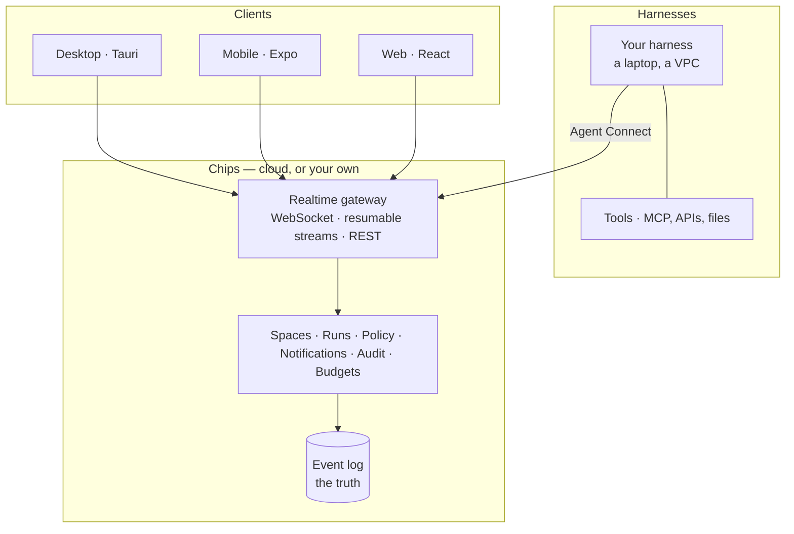

Clients and harnesses connect to the same realtime edge. Harnesses come in through an open protocol, so
any framework can join and enterprise data can stay in the customer's own cloud.



The gold edge is the product: **Agent Connect** is how any harness, running anywhere, becomes a
participant. Everything inside the box can live in Chips Cloud or in a customer's own cloud.

## The boundary

Chips decides nothing and executes nothing. It **brokers** decisions:

- the harness asks;
- [policy](/concepts/policy/) decides whether a person is needed;
- the person answers from whatever device is nearest;
- the answer goes back to the harness, which does the work with its own credentials.

Chips holds the decision, never the credentials. That is the sentence to keep in mind when
reading anything else here.

## Nothing inbound is required

A harness opens an outbound WebSocket, or long-polls an updates endpoint the way a Telegram bot
calls `getUpdates`. A harness on a Mac mini behind a home router works without a public address.
One with a public URL can register a webhook instead.

## Inside the server

`chipsd` is one Node process, with an inward dependency direction:

```
protocol → domain → application → infrastructure → interfaces
```

Storage, transport, media and fan-out are adapters behind ports, which is what lets the same
binary serve a Mac mini and a cluster. The rule is enforced by `dependency-cruiser` in CI, and
the current graph is in
[`docs/architecture.md`](https://github.com/arjungupta99/chips/blob/main/docs/architecture.md).
