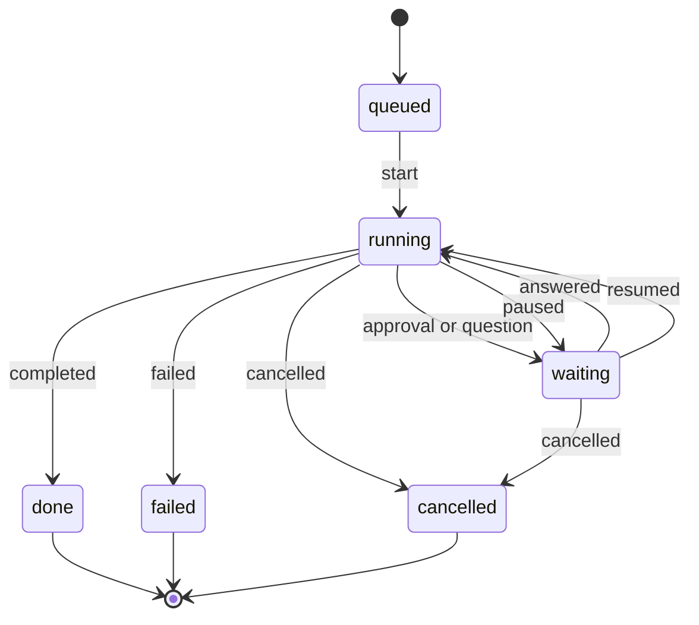

A run is a unit of harness work inside a [space](/concepts/space/). It has a goal, a
timeline of steps, artifacts, a cost and a state.

## A run's life

`done`, `failed` and `cancelled` are terminal: a run in one of them never moves again, whatever
arrives afterwards. That is what makes the run panel final rather than something that might
change while you are reading it.

Chips holds the line at the door, not only in the picture. An event into a run that has ended is
refused, bar the answer to something the run asked: a harness may ask and end its turn, and the
decision on its approval, what became of it, or the answer to its question still lands when
somebody gives it. A run that is not running cannot be paused; one that is not paused cannot be
resumed.
Two asks can be open at once, so a decision arriving while the run is already running again is
fine. And a run is somebody's: it begins with `run.started`, in a space, and a harness
writes only into runs its own token started. See [hooks mode](/connect/hooks/#every-run-is-somebodys)
for what each refusal looks like.

## Pause, steer, stop

A person can act on a run from the panel or the composer, and each action is an event the harness
receives:

| From the person | The harness gets | What Chips fills in |
| --- | --- | --- |
| Pause, Resume | [`run.pause`](/reference/events/run-pause/), [`run.resume`](/reference/events/run-resume/) | `by`, from the credential |
| Stop | [`run.cancel`](/reference/events/run-cancel/); the run ends as cancelled | `by` |
| Steer, or `/steer`, `/followup`, `/interrupt` | [`run.steer`](/reference/events/run-steer/) with its `mode` | `from`: who said it, and their role in the space |

A message sent while a run is going comes back with a receipt: `queued`, for the harness's next
look, or `steered`. A plain message is queued; a steer or an interrupt is steered; a follow-up is
queued. The harness gets the same receipt beside the message. See
[the WebSocket](/connect/websocket/#receipts).

## Whose, and from where

A run begins with [`run.started`](/reference/events/run-started/), in a space, and carries two
things about where it came from. `session_ref` names the [session](/concepts/session/) — the
visit — so two processes attached to one space are told apart and the transcript is one click
away. `goal_from` says who said the goal: `harness` means a person asked for this at the
harness's own surface — a prompt typed where the harness itself listens — and Chips draws it as
*their* message, marked *at* the harness, above the answer; `chips` means it arrived from a
message in the space
that is already on screen, so it is not drawn twice. Either way the room's header and the run
panel leave the goal out, for the same reason. A harness that says neither gets no line, which is
right for a goal nobody typed, and the header and the run panel are where that goal is read.

## What builds one

The interface is progressive. The minimum is three events — a run started, a message, a run
completed — and every extra event upgrades what the person sees.

| Send | And you get |
| --- | --- |
| [`run.started`](/reference/events/run-started/) with a `plan` | A timeline of hollow steps |
| [`run.status`](/reference/events/run-status/) | The harness's typing indicator, with a verb phrase |
| [`run.plan`](/reference/events/run-plan/) | The steps still to come replaced; what is done keeps its place |
| [`step.log`](/reference/events/step-log/) | Receipts; on the run panel a plan's step fills in, and steps outside any plan fold into a stretch — "12 tool calls · 1m 40s" — between the moments that matter |
| [`approval.request`](/reference/events/approval-request/) | An [approval](/concepts/approval/) card |
| [`context.usage`](/reference/events/context-usage/) | The context ring |
| [`usage`](/reference/events/usage/) | The cost meter |
| [`run.completed`](/reference/events/run-completed/) | A summary card, and status Done |

A summary that repeats one of the run's own messages word for word — the last, or one a few
messages back, a file and a question having come between — is drawn once: the message's own
bubble becomes the summary card, with the receipt beneath it, rather than the same sentence
twice. Say the answer as a message and summarise it in fewer words, or say it once as the
summary; either reads well.

## Cost

Cost rolls up the trail and is always labelled an estimate. A [`usage`](/reference/events/usage/)
with `scope: "run"` is the run's total so far and replaces what was there; one with `scope:
"step"` or `"lane"` adds to it. A harness may send a `cost` of its own; when it does not, Chips
estimates one at ingest from the workspace's price table — dollars per million tokens, per
model, matched by the fragment of the model's name the table knows — and records it on the
event, so the meter and the audit read the same number. A model the table cannot price gets no
cost, and the meter shows tokens alone rather than a made-up figure. So does a `usage` with no
`input_tokens`: a harness that knows only its tokens out sends those, they are counted, and the
run's tokens in stay as they were. A harness that knows only what the work cost sends `cost` with
no tokens at all, and the run's counts stay as they were (ADR 0162). A workspace's rows sit on top
of the defaults; the table lives on the workspace row, a setting rather than a projection.

## Context

Context stays per harness and is never rolled up: a lead's context ring is about the lead, not
about the work it routed away. The ring turns amber at 70 percent and red at 90. A
[`context.usage`](/reference/events/context-usage/) or a [`checkpoint`](/reference/events/checkpoint/)
with `compacted: true` leaves a tick on the run's timeline, because behaviour changes after one.
