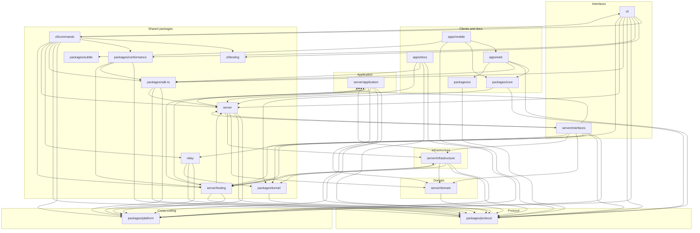

# Architecture

> The graph in this file is generated. Edit the prose in
> `tools/architecture/architecture.template.md` and run `pnpm gen:architecture`.
> CI fails if the file is stale.

Chips is ports and adapters with an inward dependency direction. The rule is
[ADR 0016](decisions/0016-ports-and-adapters.md); this page is what it looks like today.

## The layers

```
protocol  ->  domain  ->  application  ->  infrastructure  ->  interfaces
```

| Layer | Where | What lives there | May import |
|---|---|---|---|
| **protocol** | `packages/protocol` | Zod schemas for every Agent Connect event, and the types, JSON Schema and reference generated from them. | Nothing of ours. |
| **domain** | `server/src/domain` | Pure code: the policy engine, the run and lane state machines, invariants. No I/O, no framework. | `protocol` |
| **application** | `server/src/application` | Use cases — post a message, request an approval, resolve it, route a task — and the ports they depend on: storage, transport, blob store, job queue, clock, id generator, fan-out. | `protocol`, `domain` |
| **infrastructure** | `server/src/infrastructure` | Adapters: Kysely repositories, the WebSocket and HTTP transports, media jobs, the relay. | `protocol`, `domain`, `application` |
| **interfaces** | `server/src/interfaces`, `cli` | Routes, socket handlers, the command line. | everything inward |

`packages/platform` sits **beside** the layers rather than inside them. It holds the typed
configuration, the logger, the OpenTelemetry instruments, id generation and the clock. Anything
may import it; it may import nothing of ours. That is what keeps a cross-cutting concern from
becoming a back door through which an outer layer reaches an inner one.

`packages/ui` is the design system — the blueprint's tokens, primitives and cards — and
`packages/core` the protocol client and state the web and mobile apps share. Both belong to
the clients: they may import `packages/protocol`, and `core` the tunnel, and nothing else of
ours; no server layer imports them.

`packages/tunnel` is the end-to-end tunnel between a phone and its server (M4.1, ADR 0039): a
Noise handshake over WebCrypto, requests and sockets as messages inside it, and both ends of the
relay's conversation. It imports the protocol and nothing else, and the server, the client core
and the relay all import it. `relay/` is the switchboard itself, a process of its own beside
`server/` and `cli/`: it reads the protocol's control frames and the tunnel's key proof, forwards
ciphertext, and imports no server layer.

## The graph

<!-- generated:graph -- do not edit by hand; run pnpm gen:architecture -->



<!-- /generated:graph -->

## What CI enforces

`pnpm lint:deps` runs [`dependency-cruiser`](../.dependency-cruiser.cjs) over the tree. These
rules are errors:

| Rule | What it forbids |
|---|---|
| `no-circular` | Any dependency cycle. |
| `no-unresolvable` | An import that does not resolve. |
| `not-to-dev-dep` | Shipped code importing a `devDependency`. |
| `not-to-unlisted-dep` | A runtime import not declared in the importing package's `package.json`. |
| `no-deprecated-core` | Deprecated Node core modules. |
| `protocol-is-innermost` | `packages/protocol` importing any layer of ours. |
| `domain-not-to-outer` | The domain layer importing application, infrastructure or interfaces. |
| `domain-not-to-framework` | The domain layer importing Hono, `ws`, Kysely, `better-sqlite3`, `pg`, `pino`, `sharp`, React, Vite or OpenTelemetry. |
| `application-not-to-outer` | A use case importing an adapter instead of a port. |
| `infrastructure-not-to-interfaces` | An adapter reaching back into routes, socket handlers or the CLI. |
| `platform-imports-nothing-of-ours` | `packages/platform` importing anything in the repository. |
| `clients-not-to-server` | `packages/ui` or `packages/core` importing anything of ours but the protocol. |
| `server-not-to-clients` | `server/`, `cli/` or `relay/` importing `packages/ui` or `packages/core`. |
| `ui-and-core-are-siblings` | The design system and the client core importing each other. |
| `no-deep-import-into-package` | Reaching past a package's `index.ts`. A stylesheet the package exports, such as `@chipschat/ui/styles.css`, is an entry point of its own and is allowed. |
| `no-deep-import-between-packages` | The same, between packages. |

A rule that never fires is not a guardrail. `tools/guardrails/fixtures` is a miniature
repository in which each of those rules is broken on purpose, and
`tools/guardrails/dependency-cruiser.test.ts` asserts that each one is caught — and that
nothing else fires, so the fixtures stay a precise description of the rules.

The one rule without a fixture is `not-to-dev-dep`, which needs an installed dependency tree to
classify. It is stock dependency-cruiser configuration; only its `from` filter is ours.

## Other guardrails

| Check | Where | Fails on |
|---|---|---|
| Coverage thresholds | `vitest.config.ts` | Below 80 percent overall, or below 90 percent on `packages/protocol` and `server/src/domain`. Thresholds may only go up. |
| One reader of `process.env` | `biome.json`, rule `style/noProcessEnv` | Any file except `packages/platform/src/config/environment.ts` reading the environment directly. |
| Cognitive complexity | `biome.json`, rule `complexity/noExcessiveCognitiveComplexity` | A function over 12. |
| Typed configuration | `packages/platform/src/config` | A setting that is not in the Zod schema, or an environment variable not in `ENVIRONMENT_BINDINGS`. |
| Architecture graph | `tools/architecture/generate.mjs --check` | This file being out of date with the source tree. |

## Determinism

Time and identifiers come through ports so tests do not sleep and do not guess:
`systemClock` and `manualClock` in `packages/platform/src/time`, `createIdGenerator` in
`packages/platform/src/ids`. Production wires the system clock and a monotonic ULID generator;
tests wire a clock they drive by hand and a generator with fixed randomness.
